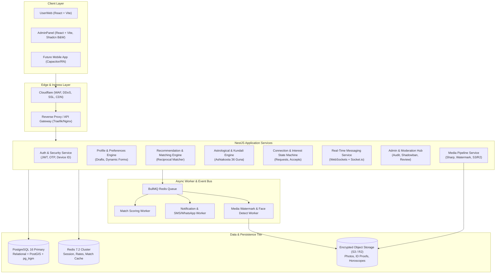
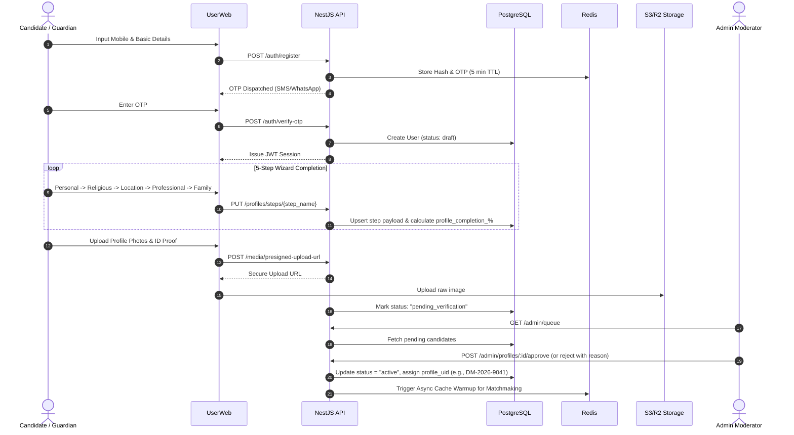
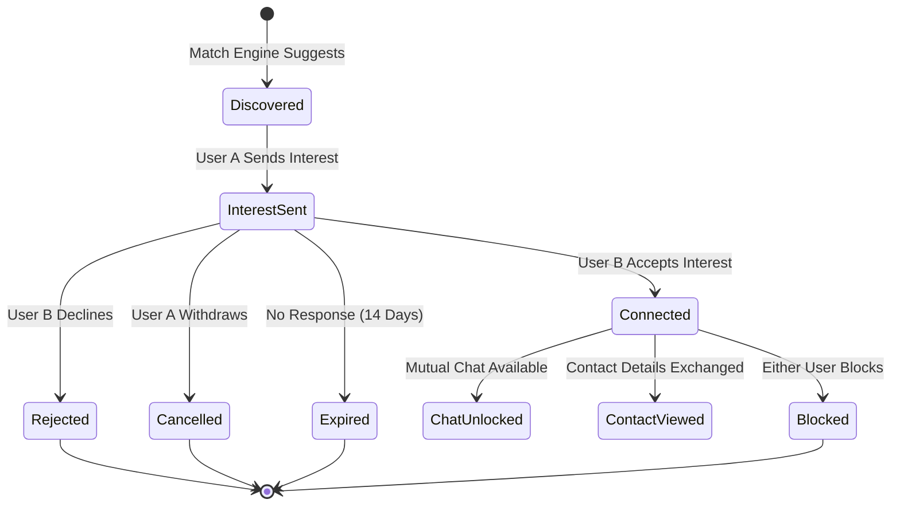
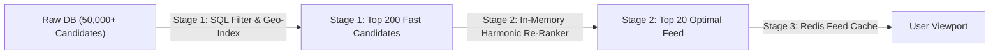
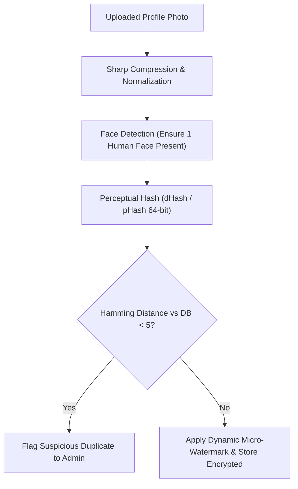
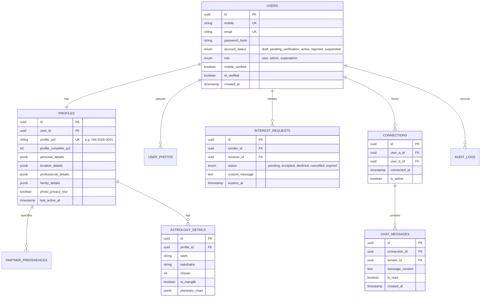

# Enterprise Architecture Blueprint & Algorithmic Design: Matrimony Platform

**Role**: Principal Platform & Architecture Engineer  
**Date**: September 2026  
**Status**: APPROVED ARCHITECTURE SPECIFICATION  

---

## 1. System Overview & Retained Foundations

This specification defines the complete end-to-end architecture and algorithmic engine for the matrimony platform, retaining:
1. **Core Tech Stack**: NestJS (TypeScript), PostgreSQL (relational core + jsonb metadata), Redis (caching, pub/sub, rate-limiting, job queue), React + Vite (UserWeb & AdminPanel), Tailwind CSS, Bun runtime.
2. **Design Language**: 
   - **UserWeb**: `#C42369` (Deep Ruby Cerise) with `#FAF7F2` (Warm Alabaster) and warm neutrals.
   - **AdminPanel**: Pure Black & White high-contrast shadcn/ui palette (`#000000`, `#ffffff`, `#09090b`, `#27272a`).
3. **Domain Entities**: Personal Details, Religious & Astrological, Location/Residency, Professional/Educational, Family/Lifestyle, Verification Flags, Partner Preferences.
4. **Admin Flow**: Verification queue, document audit, approve/reject state machine, and metric dashboards.

---

## 2. High-Level System Architecture (C4 Container View)

---

## 3. End-to-End Platform Flows

### Flow 1: Registration, Multi-Step Profiling & Verification Flow

---

### Flow 2: Double Opt-in Connection & Interaction Lifecycle

---

## 4. Deep-Dive: Core Algorithmic Engines

### Algorithm 1: Reciprocal Two-Sided Compatibility Engine
#### 1. Why / Problem
Standard recommendation algorithms (like Netflix or Amazon) recommend items to users without requiring the item to "like" the user back. Matrimony is fundamentally **bilateral (reciprocal)**: User $A$ must be attractive to User $B$, and User $B$ must also satisfy User $A$'s strict criteria. Recommending candidates who would immediately reject the user results in high churn, frustration, and ghosting.

#### 2. Solution: Reciprocal Harmonic Scoring Formulation
The total compatibility score between candidate $A$ and candidate $B$ is calculated using a **Harmonic Mean** of both directional preferences:

$$\text{Score}(A, B) = 2 \cdot \frac{S(A \to B) \times S(B \to A)}{S(A \to B) + S(B \to A) + \epsilon}$$

Where $S(A \to B)$ is how well $B$ matches $A$'s declared preferences, and $S(B \to A)$ is how well $A$ matches $B$'s preferences.

#### 3. Mathematical Factor Breakdown
Each directional score $S(X \to Y) \in [0, 100]$ is computed as:

$$S(X \to Y) = \sum_{k=1}^{n} w_k \cdot f_k(X_{\text{pref}}, Y_{\text{actual}})$$

| Dimension ($k$) | Weight ($w_k$) | Evaluation Function ($f_k$) | Logic & Penalties |
| :--- | :--- | :--- | :--- |
| **Strict Dealbreakers** | Filter Gate | Boolean $(0 \text{ or } 1)$ | Marital Status, Religion/Subcaste, Diet (if strict). If $0$, candidate is immediately discarded. |
| **Age Span** | 20% | Gaussian Decay | $1.0$ if within preferred range $[a_{\min}, a_{\max}]$. Decreases by $\exp(-\lambda \cdot \Delta^2)$ outside range. |
| **Height Compatibility** | 15% | Linear Tolerance | $1.0$ within target bracket; $-0.15$ per inch deviation. |
| **Location & Proximity** | 20% | Haversine Geo / Tier Match | $1.0$ for same city/district; $0.75$ for same state; $0.3$ otherwise. |
| **Education & Profession** | 20% | Ordinal Hierarchy Matrix | Matching education tier (Postgraduate, Engineer/Doctor, Graduate). |
| **Lifestyle & Habits** | 15% | Jaccard Similarity | Overlap in smoking, drinking, vegetarian/vegan lifestyle. |
| **Horoscope / Guna** | 10% | Scaled Guna Score | $\frac{\text{Guna Score}}{36}$ (if kundali matching is enabled). |

---

### Algorithm 2: Ashtakoota 36 Guna Kundali Milan Engine
#### 1. Why / Problem
In Indian matrimonial systems (specifically Dhobi/Hindu community traditions), astrological alignment (Kundali Milan) is often a prerequisite before families proceed to meetings. Relying on external third-party paid APIs introduces latency, recurring API costs, and privacy exposure.

#### 2. Solution: Native Mathematical Ashtakoota Implementation
The system calculates the **8 Kootas (Ashtakoota)** totaling 36 points based on the bride's and groom's Moon Constellation (*Nakshatra*) and Moon Sign (*Rashi*):

| Koota | Max Points | Aspect Governed | Algorithmic Evaluation |
| :--- | :---: | :--- | :--- |
| **Varna** | 1 | Spiritual compatibility | Based on 4 Varnas associated with Rashis. |
| **Vashya** | 2 | Mutual attraction & control | Based on 5 classes (Chatushpad, Manav, Jalchar, Vanachara, Keeta). |
| **Tara** | 3 | Longevity & destiny | $(\text{Nakshatra}_B - \text{Nakshatra}_A) \pmod 9$. Checked in both directions. |
| **Yoni** | 4 | Biological / physical affinity | Based on 14 animal classifications and mutual friendship/enmity matrix. |
| **Graha Maitri** | 5 | Psychological & intellectual bond | Relationship between planetary lords of the two Rashis (Friend, Neutral, Enemy). |
| **Gana** | 6 | Temperament (Deva, Manushya, Rakshasa) | Full (6), Moderate (5/1), or Discord (0) points based on temperament pairing. |
| **Bhakoot** | 7 | Health, family prosperity | Relative Rashi positions (Distances: 2/12, 6/8, 9/5 produce Dosha unless canceled). |
| **Nadi** | 8 | Genetic, physiological & lineage health | Three Nadis (Aadi, Madhya, Antya). Same Nadi yields 0 (Nadi Dosha); Different yields 8. |
| **Total** | **36** | **$\ge 18$ considered acceptable; $\ge 24$ considered auspicious** |

#### 3. Manglik Dosha Engine
Evaluates Mars (*Kuja*) placement from Ascendant (*Lagna*), Moon (*Chandra*), and Venus (*Shukra*) in houses 1, 2, 4, 7, 8, 12. If present in both candidates, the Dosha is marked as canceled (*Manglik-Manglik Compatibility*).

---

### Algorithm 3: High-Performance Discovery, Geo-Proximity & Feed Ranking
#### 1. Why / Problem
Calculating the two-sided compatibility score across 50,000+ candidates for every scroll is an $O(N)$ operation that would crash PostgreSQL. 

#### 2. Solution: Two-Tier Search Pipeline (Candidate Selection $\to$ Heavy Re-ranking)

1. **Stage 1 (Indexed Fast Gate in PostgreSQL)**:
   - Filter opposite gender, `status = 'active'`, `is_deleted = false`.
   - Age bounding box: `age BETWEEN (pref_min_age - 2) AND (pref_max_age + 2)`.
   - Geo-filter: PostGIS bounding box or indexed district/state codes.
   - Limit candidate pool to top 200 most recent active profiles.
2. **Stage 2 (In-Memory Microservice / Redis Scorer)**:
   - Compute full reciprocal harmonic score.
   - Inject freshness boost: $\text{FreshnessBoost} = \exp(-\alpha \cdot \text{days\_since\_active})$.
   - Inject activity penalty: profiles inactive for $>60$ days are downranked.
3. **Stage 3 (Cursor-Based Pagination)**:
   - Returns sorted UUIDs with base64 encoded cursor `(score, last_user_id)`.

---

### Algorithm 4: Trust, Safety & Perceptual Hash Duplicate Detection
#### 1. Why / Problem
Matrimony platforms are targets for scammers, duplicate fake profiles, catfishing, and reuse of stolen celebrity photos.

#### 2. Solution: Multi-Layer Trust Pipeline

- **Hamming Distance Match**: Identifies if the exact same image was used across multiple phone numbers or user accounts even if cropped or resized.
- **Dynamic Watermarking**: Embeds subtle semi-transparent `DM-{USER_ID}` across profile photos to prevent unauthorized downloading and misuse on social media.
- **Privacy Shields**: Allows female candidates to toggle "Blur Photo Until Request Accepted", returning an on-the-fly blurred placeholder (`sharp.blur(30)`).

---

## 5. Architectural Decision Records (ADRs)

### ADR-01: Direct PostgreSQL Stored Functions vs ORM for Core Queries
- **Decision**: Keep complex domain transactions (Profile Registration, Admin Batch Approval, Match Candidates) in PostgreSQL Functions (`PL/pgSQL`), while using clean NestJS TypeORM/Prisma or Kysely for standard CRUD.
- **Why**: Stored functions execute within the database engine with zero network roundtrip latency for multi-table updates. Atomic row locks prevent race conditions during account state transitions.
- **Trade-off**: Requires database migration tracking; solved via standardized SQL versioned migration files in `/Backend/migrations`.

### ADR-02: Asynchronous Job Processing via BullMQ + Redis
- **Decision**: Offload OTP dispatch, email/SMS notifications, image watermarking, and match score cache invalidation to BullMQ workers.
- **Why**: Image processing and SMS gateway timeouts must never block HTTP request threads.
- **Solution**: Decoupled NestJS producers with resilient worker retry policies (exponential backoff).

### ADR-03: Real-Time Communication via Socket.io with Redis Adapter
- **Decision**: Use Socket.io with `@socket.io/redis-adapter` for live messaging, typing indicators, and real-time interest accept alerts.
- **Why**: Allows horizontal scaling of NestJS backend instances without sticky session bottlenecks.

### ADR-04: Strict Zero-Trust Admin Console
- **Decision**: Admin panel remains on an isolated subpath/domain with dedicated JWT roles (`admin`, `superadmin`), IP allowlisting capability, and immutable audit logs.
- **Styling Rationale**: Pure monochrome (#000000 / #ffffff) shadcn design guarantees zero visual fatigue during prolonged document audits and maximum data density.

---

## 6. Target Database Schema Architecture

---

## 7. Step-by-Step Implementation Roadmap

| Milestone | Deliverables | Key Focus Areas |
| :--- | :--- | :--- |
| **Phase 1: Foundation & Identity** | - Secure OTP + JWT Session Auth - Complete 5-Step Dynamic Wizard - Image Upload with S3/R2 presigned URLs | Mobile verification, state validation, profile completion calculation. |
| **Phase 2: Admin Moderation Engine** | - Verification Queue UI (Black & White shadcn) - Document & Photo verification - Approve / Reject with audit trail | Fraud prevention, profile UID generation, audit logging. |
| **Phase 3: Search, Discovery & Geo-Engine** | - PostGIS / District filter engine - Two-Sided Reciprocal Matcher - Cursor-based infinite scroll feed | Search performance, sub-50ms response times, caching in Redis. |
| **Phase 4: Astrology & Kundali Engine** | - 36 Guna Ashtakoota Milan algorithm - Manglik Dosha calculator - Match report card UI component | Accurate mathematical calculation without external dependencies. |
| **Phase 5: Interactions & Double Opt-in** | - Send / Receive Interest lifecycle - Accept / Decline state machine - Contact exchange privacy gate | Double opt-in security, expiry timers, notification triggers. |
| **Phase 6: Real-Time Communication** | - WebSocket Gateway with Redis Pub/Sub - 1-on-1 End-to-End Chat - Read receipts & online presence | Privacy controls, message encryption, connection verification. |
| **Phase 7: Trust, Safety & Monetization** | - Perceptual photo hash duplicate detection - Photo watermarking & blur filter - Premium membership tiers (Connects count) | Fraud resistance, revenue generation, high availability. |
